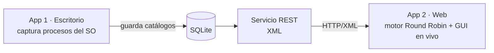
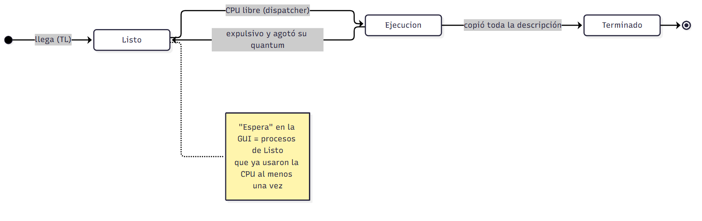
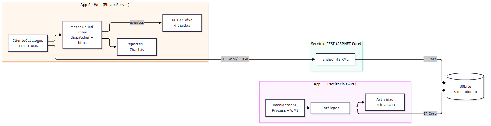
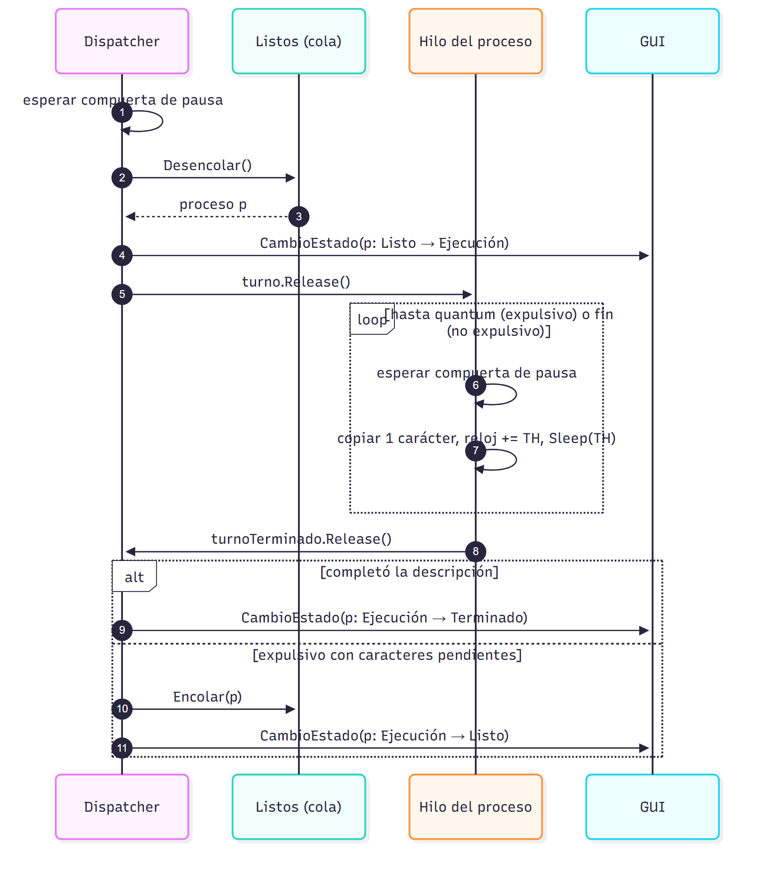

# Simulador de Gestión de Procesos

[](https://github.com/isKarTuX/simulador-gestion-procesos/actions/workflows/ci.yml)


Simulador del **modelo de estados de un proceso** y del algoritmo de planificación **Round Robin**, desarrollado para el laboratorio *Gestión de procesos* del curso de Sistemas Operativos (Ingeniería de Sistemas, Universidad de Córdoba, 2026-II).

El sistema captura procesos reales del sistema operativo, los guarda en catálogos, los expone por un servicio REST en XML y los simula en una aplicación web donde cada proceso es un hilo que compite por la CPU.



## Funcionalidades

**App 1 · Escritorio (WPF)**
- Captura N procesos en ejecución, ordenados por mayor uso de CPU o de memoria.
- Obtiene PID, nombre, usuario, descripción y prioridad (procesos del SO = no expulsivos).
- Agrupa los procesos en catálogos numerados y los persiste en base de datos.
- Ejecuta la actividad de cada proceso: escribir su descripción en un archivo, carácter por carácter.

**Servicio REST (ASP.NET Core)**
- `GET /api/catalogos` · `GET /api/catalogos/{id}/procesos` · `GET /api/planificacion/{id}`, todos en XML.

**App 2 · Web (Blazor Server)**
- Simulación Round Robin con un hilo por proceso y estados Listo, Ejecución y Terminado.
- Panel en vivo con las bandas Listos, Ejecución, Espera y Terminado.
- Iniciar, pausar, reanudar y reiniciar en cualquier momento.
- Reportes: listado de ejecución, listado de no expulsivos y gráfico Proceso vs TurnaRound.

## Estructura

```
├─ src/
│  ├─ SimuladorProcesos.Core/      modelos, contrato XML, fórmulas (sin dependencias)
│  ├─ SimuladorProcesos.Data/      EF Core + SQLite
│  ├─ SimuladorProcesos.Desktop/   App 1 (WPF)
│  ├─ SimuladorProcesos.Api/       servicio REST XML
│  ├─ SimuladorProcesos.Engine/    motor Round Robin, estructuras dinámicas, hilos
│  └─ SimuladorProcesos.Web/       App 2 (Blazor Server)
├─ tests/                          xUnit: Core, Engine, Api
├─ docs/
│  ├─ PLAN.md                      olas de trabajo, metas y restricciones
│  ├─ diagramas.md                 estados, arquitectura, secuencia del dispatcher
│  ├─ adr/                         decisiones de arquitectura
│  └─ contrato/                    ejemplos XML del servicio
├─ CONTEXT.md                      requisitos, contrato y decisiones (fuente de verdad)
└─ AGENTS.md                       reglas de trabajo para personas y agentes de IA
```

## Cómo ejecutarlo

Requisitos: Windows 10/11 y [.NET 10 SDK](https://dotnet.microsoft.com/download/dotnet/10.0).

```bash
dotnet build SimuladorProcesos.slnx
```

```bash
dotnet run --project src/SimuladorProcesos.Desktop
```

```bash
dotnet run --project src/SimuladorProcesos.Api
```

```bash
dotnet run --project src/SimuladorProcesos.Web
```

1. En la App de escritorio crea un catálogo (N procesos, criterio CPU o memoria).
2. Con la Api corriendo (`http://localhost:5080`), abre la Web (`http://localhost:5090`).
3. Elige el catálogo, define TH y quantum, e inicia la simulación.

Pruebas:

```bash
dotnet test SimuladorProcesos.slnx
```

## Capturas

Diagramas exportados a PNG con `npx -y @mermaid-js/mermaid-cli@12.0.0` (fondo blanco, escala 2, todos ≤ 300 KB):

| Diagrama | PNG |
|---|---|
| Modelo de estados |  |
| Arquitectura |  |
| Secuencia del dispatcher |  |

Fuente Mermaid de los tres: [docs/diagramas.md](docs/diagramas.md).

> **Capturas de las apps (pendientes):** este entorno no tiene ventana WPF ni navegador, así que no se generaron capturas reales y no se inventó ninguna. Quedan para el humano, con pasos exactos:
>
> 1. `docs/img/app1-catalogo.png`: `dotnet run --project src/SimuladorProcesos.Desktop`, crear un catálogo (N = 5, criterio CPU, número consecutivo, nombre descriptivo) y capturar la ventana con el grid de procesos lleno.
> 2. `docs/img/api-catalogos-xml.png`: con la Api corriendo, abrir `http://localhost:5080/api/catalogos` en el navegador y capturar el XML.
> 3. `docs/img/web-simulacion-mitad.png`: con Api y Web corriendo, iniciar una simulación con un catálogo mixto y capturarla a mitad, con las 4 bandas (Listos, Ejecución, Espera, Terminado) ocupadas.
> 4. `docs/img/web-reportes.png`: al terminar la simulación, abrir `/reportes` y capturar las tablas más el gráfico Proceso vs TurnaRound.

## Demo en 5 minutos

Todos los comandos de abajo se ejecutaron y verificaron el 11/10/2026 (`dotnet --version` → `10.0.401`).

0. Compilar (0 advertencias, 0 errores):

```bash
dotnet build SimuladorProcesos.slnx
```

1. Arrancar la Api (terminal 1) y comprobar que responde XML:

```bash
dotnet run --project src/SimuladorProcesos.Api
curl -H "Accept: application/xml" http://localhost:5080/api/catalogos
```

Respuesta esperada: `200` con `Content-Type: application/xml` y un cuerpo `<Catalogos />` (vacío si aún no hay catálogos) o con un `<Catalogo>` por catálogo. Un id inexistente devuelve `404` en XML: `curl -H "Accept: application/xml" http://localhost:5080/api/catalogos/9999/procesos`.

2. Arrancar la Web (terminal 2) y abrirla en el navegador:

```bash
dotnet run --project src/SimuladorProcesos.Web
```

Abrir `http://localhost:5090` (verificado: responde `200` con el HTML de Blazor). Si la Api está apagada, la página muestra un aviso amable con botón Reintentar.

3. Crear un catálogo (terminal 3, requiere Windows con interfaz gráfica):

```bash
dotnet run --project src/SimuladorProcesos.Desktop
```

En la App de escritorio: N = 5, criterio CPU, número consecutivo, nombre descriptivo → Capturar → Guardar. Repite con N = 8 y criterio memoria para tener dos catálogos.

4. Simular: en la Web elige el catálogo, define TH = 100 ms y quantum = 5, e Inicia. Prueba Pausar (el reloj se congela), Reanudar y Reiniciar a mitad sin errores en consola. Al terminar, abre `/reportes`: listado de ejecución, listado de no expulsivos, gráfico Proceso vs TurnaRound y anexos (TF del enunciado vs TF real).

5. Correr las pruebas (opcional, todo en verde: 409 passed, 0 failed):

```bash
dotnet test SimuladorProcesos.slnx
```

## Documentación

- [Requisitos, contrato y decisiones](CONTEXT.md)
- [Plan de trabajo](docs/PLAN.md) · [Prompts por subtarea para agentes](docs/PROMPTS.md)
- [Diagramas](docs/diagramas.md)
- Decisiones: [arquitectura y stack](docs/adr/0001-arquitectura-y-stack.md) · [concurrencia](docs/adr/0002-modelo-de-concurrencia.md) · [estructuras dinámicas](docs/adr/0003-estructuras-dinamicas.md)

## Uso de IA

Este proyecto se desarrolla con apoyo de agentes de IA (Claude Code) bajo las reglas de [AGENTS.md](AGENTS.md). Los commits asistidos llevan la línea `Co-Authored-By` correspondiente y todo el código es revisado y sustentado por el equipo.
