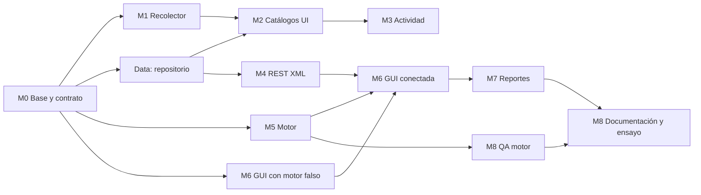

# Plan de ejecución

Cómo se construye el proyecto entre el 10 y el 20 de octubre de 2026 con un humano dirigiendo y varios agentes de IA trabajando en paralelo. Los requisitos y el detalle de cada módulo están en [`CONTEXT.md`](../CONTEXT.md) §6; aquí está el **orden**, el **dueño** y la **forma de integrar**.

## Metas

| Meta | Medida |
|---|---|
| Funcionalidad completa (30%) | Checklist de CONTEXT §11 completo el lunes 19 |
| Diseño defendible (30%) | Contrato congelado, 3 ADR, 3 diagramas, dependencias limpias entre proyectos |
| Sustentación (40%) | Al menos 3 rondas de `/sustentacion todo` con ≥ 8/10 antes del martes 20 |
| Calidad | CI en verde en `main` todo el tiempo; motor con pruebas de cada transición |

## Restricciones

- **Fecha dura**: martes 20/10/2026, 1:30 p.m. Funcionalidades congeladas el domingo 18 por la noche.
- **Enunciado manda**: Round Robin, milisegundos, un hilo por proceso, XML por REST, catálogos en BD, estructuras dinámicas por estado.
- **Windows**: la App 1 usa WMI y WPF; el CI corre en `windows-latest`.
- **El motor no se recorta**: si hay atraso se sacrifica pulido visual de la GUI, nunca el motor ni sus pruebas.

## Grafo de dependencias

## Olas

Cada módulo está dividido en **subtareas** que tocan archivos distintos, así varias corren a la vez sin conflictos. Los prompts listos para copiar, los archivos de cada una y su criterio de hecho están en [`PROMPTS.md`](PROMPTS.md).

| Ola | Fechas | Subtareas (issue) | Integración al cerrar |
|---|---|---|---|
| **0** | Sáb 10 | Base, contrato, andamiaje de interfaces (hecho) · preguntas al profesor (#1) | `main` compila y CI en verde |
| **1** | Sáb 10 – Mié 14 | 1.1 Repositorio (#12) · 1.2 Endpoints XML (#13) · 1.3 Selección CPU/memoria (#14) · 1.4 Metadatos (#15) · 1.5 Actividad (#16) · 1.6 Ventana de catálogos (#17) · 1.7 Estructuras (#18) · 1.8 Cálculos (#19) · 1.9 Planificador (#20) · 1.10 Página de simulación (#21) · 1.11 Bandas y tarjetas (#22) · 1.12 Cliente REST (#23) | **Mié 14**: Data + Api dan XML real; motor sin hilos probado; GUI anima con el simulador falso |
| **2** | Jue 15 – Sáb 17 | 2.1 Hilos y pausa (#24) · 2.2 App 1 con servicios reales (#25) · 2.3 Web con motor real (#7) · 2.4 QA del motor (#8) | **Sáb 17**: flujo punta a punta App 1 → BD → REST → App 2 en vivo |
| **3** | Dom 18 | 3.1 Tablas (#26) · 3.2 Gráfico (#27) · 3.3–3.5 Notas de sustentación (#28–#30) · 3.6 README y capturas (#31) · 3.7 QA punta a punta (#32) | **Dom 18 noche**: congelar, etiqueta `v1.0.0-rc1` |
| **4** | Lun 19 | Correcciones de QA · `/sustentacion todo` x3 · demo grabada | Etiqueta `v1.0.0` |
| — | Mar 20 | Solo correcciones críticas. Entrega 1:30 p.m. | Release en GitHub |

## Cómo trabajar con varios agentes

1. **Una subtarea = un agente = una rama = un worktree.** Cada subtarea declara sus archivos en [`PROMPTS.md`](PROMPTS.md), así dos agentes nunca editan el mismo archivo.
2. **Lanzar**: desde la sesión principal, `/orquestar 1` lanza una tanda en segundo plano (cada subagente en su propio worktree). Alternativa manual: en la app de Claude, una sesión nueva con worktree por subtarea, pegando su prompt de [`PROMPTS.md`](PROMPTS.md).
3. **Integrar**: tú revisas cada PR (el de M5 línea por línea), esperas el CI y haces *squash merge*. Orden de merge: lo que otros necesitan primero (Data → M4 → M2; M5 → M6).
4. **Sincronizar**: después de cada merge, los agentes activos hacen `git pull --rebase origin main` en su rama.
5. **Auditar**: cuando M5 esté en PR, lanza el agente `qa` sobre esa rama antes de fusionar.
6. **Aprender lo que se fusiona**: al final de cada día, `/sustentacion <módulo>` sobre lo que entró a `main`. La sustentación es individual; lo que no puedas explicar, simplifícalo.

## Puntos de control diarios

- ¿`main` está en verde?
- ¿Qué issues de la ola actual siguen abiertos y por qué?
- ¿Hay algún cambio de contrato pendiente? (debe ir en su propio PR, skill `contrato-xml`)
- ¿Respondió el profesor? Si sí, actualizar CONTEXT §3 y abrir issues por cada ajuste.

## Convenciones de GitHub

- **Ramas**: `feat/`, `fix/`, `docs/`, `test/`, `contrato/` + `mN-descripcion`.
- **Commits**: Conventional Commits con alcance = proyecto (`feat(api): ...`, `test(engine): ...`).
- **Etiquetas**: `modulo:M0`…`modulo:M8`, `ola:0`…`ola:4`, `agente:*`, `epica` (agrupa subtareas), `contrato`, `bloqueo`, `bug`.
- **Milestone**: "Entrega 20/10" con todos los issues.
- **Versiones**: `v0.x` durante el desarrollo, `v1.0.0-rc1` al congelar, `v1.0.0` la entrega.
