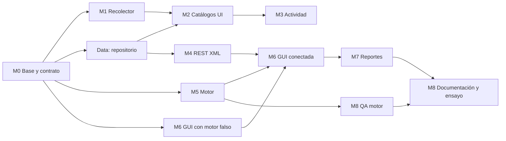

# Plan de ejecución

Cómo se construye el proyecto entre el 10 y el 20 de octubre de 2026 con un humano dirigiendo y varios agentes de IA trabajando en paralelo. Los requisitos y el detalle de cada módulo están en [`CONTEXT.md`](../CONTEXT.md) §6; aquí está el **orden**, el **dueño** y la **forma de integrar**.

## Metas

| Meta | Medida |
|---|---|
| Funcionalidad completa (30%) | Checklist de CONTEXT §11 completo el lunes 19 |
| Diseño defendible (30%) | Contrato congelado, 3 ADR, 3 diagramas, dependencias limpias entre proyectos |
| Sustentación (40%) | Al menos 3 rondas de `/sustentacion todo` con ≥ 8/10 antes del martes 20 |
| Calidad | CI en verde en `main` todo el tiempo; motor con pruebas de cada transición |

## Restricciones

- **Fecha dura**: martes 20/10/2026, 1:30 p.m. Funcionalidades congeladas el domingo 18 por la noche.
- **Enunciado manda**: Round Robin, milisegundos, un hilo por proceso, XML por REST, catálogos en BD, estructuras dinámicas por estado.
- **Windows**: la App 1 usa WMI y WPF; el CI corre en `windows-latest`.
- **El motor no se recorta**: si hay atraso se sacrifica pulido visual de la GUI, nunca el motor ni sus pruebas.

## Grafo de dependencias

## Olas

Cada ola es un conjunto de issues que pueden trabajarse **a la vez** porque solo dependen de cosas ya fusionadas en `main`. Lánzalas con `/orquestar <ola>` o abriendo una sesión por agente.

| Ola | Fechas | Issues (agente → rama) | Integración al cerrar |
|---|---|---|---|
| **0** | Sáb 10 | M0 base, contrato y repo (hecho en esta sesión) · enviar preguntas al profesor (humano) | `main` compila y CI en verde |
| **1** | Dom 11 – Mié 14 | Data + M4 (`backend` → `feat/m4-api-xml`) · M1 (`desktop` → `feat/m1-recolector`) · M5 estructuras y motor (`motor` → `feat/m5-motor`) · M6 GUI con `SimuladorFalso` (`frontend` → `feat/m6-gui`) | **Mié 14**: la App 1 crea un catálogo real y el `.http` lo devuelve en XML |
| **2** | Mié 14 – Sáb 17 | M2 + M3 (`desktop` → `feat/m2-m3-catalogos-actividad`) · M6 conectar motor real y cliente REST (`frontend` → `feat/m6-integracion`) · QA del motor (`qa`) | **Sáb 17**: flujo punta a punta App 1 → BD → REST → App 2 en vivo |
| **3** | Dom 18 | M7 reportes y gráfico (`frontend` → `feat/m7-reportes`) · correcciones de QA · M8 diagramas y README (`docs/m8-...`) | **Dom 18 noche**: congelar funcionalidades, etiqueta `v1.0.0-rc1` |
| **4** | Lun 19 | QA final punta a punta · ensayo `/sustentacion` x3 · demo grabada de respaldo | Etiqueta `v1.0.0` |
| — | Mar 20 | Solo correcciones críticas. Entrega 1:30 p.m. | Release en GitHub |

## Cómo trabajar con varios agentes

1. **Un issue = un agente = una rama = un worktree.** Así dos agentes nunca editan los mismos archivos. El mapa de propiedad está en [`AGENTS.md`](../AGENTS.md).
2. **Lanzar**: desde la sesión principal, `/orquestar 1` lanza la ola 1 en segundo plano (cada subagente en su propio worktree). Alternativa manual: en la app de Claude, nueva sesión con worktree y el mensaje *"Actúa como el agente `motor` y trabaja el issue #N siguiendo AGENTS.md"*.
3. **Integrar**: tú revisas cada PR (el de M5 línea por línea), esperas el CI y haces *squash merge*. Orden de merge: lo que otros necesitan primero (Data → M4 → M2; M5 → M6).
4. **Sincronizar**: después de cada merge, los agentes activos hacen `git pull --rebase origin main` en su rama.
5. **Auditar**: cuando M5 esté en PR, lanza el agente `qa` sobre esa rama antes de fusionar.
6. **Aprender lo que se fusiona**: al final de cada día, `/sustentacion <módulo>` sobre lo que entró a `main`. La sustentación es individual; lo que no puedas explicar, simplifícalo.

## Puntos de control diarios

- ¿`main` está en verde?
- ¿Qué issues de la ola actual siguen abiertos y por qué?
- ¿Hay algún cambio de contrato pendiente? (debe ir en su propio PR, skill `contrato-xml`)
- ¿Respondió el profesor? Si sí, actualizar CONTEXT §3 y abrir issues por cada ajuste.

## Convenciones de GitHub

- **Ramas**: `feat/`, `fix/`, `docs/`, `test/`, `contrato/` + `mN-descripcion`.
- **Commits**: Conventional Commits con alcance = proyecto (`feat(api): ...`, `test(engine): ...`).
- **Etiquetas**: `modulo:M0`…`modulo:M8`, `ola:1`…`ola:4`, `contrato`, `bloqueo`, `bug`, `docs`.
- **Milestone**: "Entrega 20/10" con todos los issues.
- **Versiones**: `v0.x` durante el desarrollo, `v1.0.0-rc1` al congelar, `v1.0.0` la entrega.
