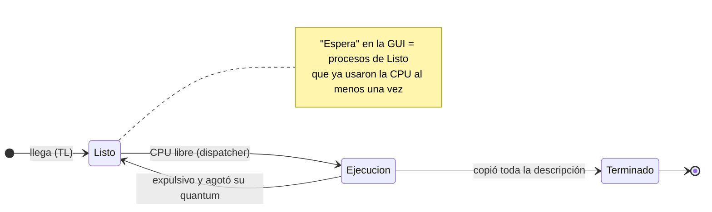
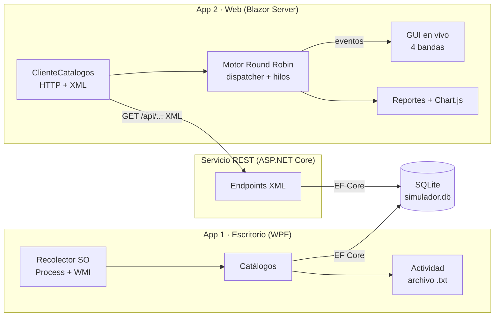
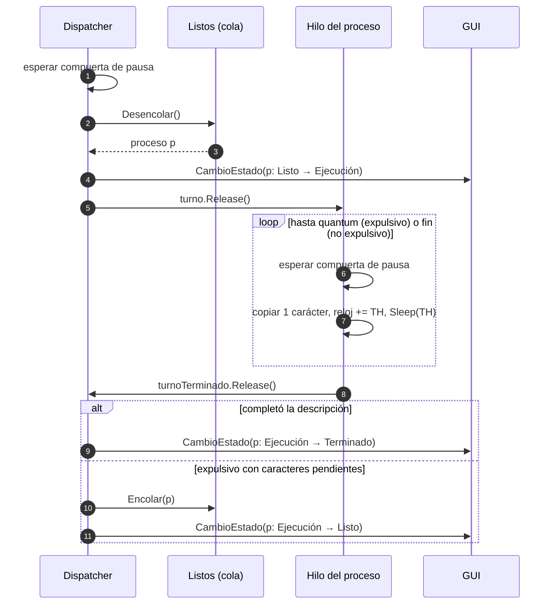

# Diagramas

GitHub renderiza estos diagramas Mermaid. Para la sustentación se pueden exportar a PNG desde [mermaid.live](https://mermaid.live).

Versiones PNG generadas con `@mermaid-js/mermaid-cli@12.0.0` (fondo blanco, escala 2): [estados](img/diagrama-estados.png) · [arquitectura](img/diagrama-arquitectura.png) · [secuencia](img/diagrama-secuencia.png).

## 1. Modelo de estados

## 2. Arquitectura

## 3. Secuencia del dispatcher (un turno)

