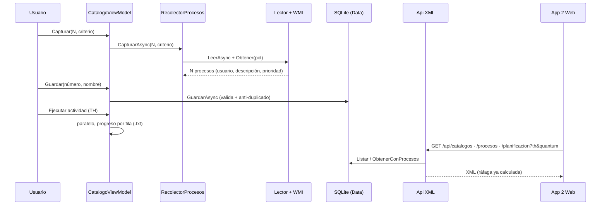

# Notas de sustentación: App 1 y servicio REST (M1, M2, M3, M4, Data)

## 1. Qué hace y por qué está diseñado así

La App 1 captura N procesos reales del SO (por CPU o memoria), los cataloga con nombre y número, y guarda cada catálogo en SQLite.
Cada proceso ejecuta su actividad: crea `<nombre>_<pid>.txt` y copia su descripción carácter por carácter esperando TH ms.
El servicio REST expone esos catálogos en XML para que la App 2 los consuma sin tocar la BD.
Lo puro (ordenar, sanear nombres, fórmulas) está separado de lo que toca el SO (Process, WMI, archivos, EF) para poder probarlo sin Windows.
El ViewModel no conoce WPF: la vista solo enlaza propiedades y comandos, y los errores se muestran como mensajes, nunca como excepciones al usuario.
La frontera App 1 → App 2 es el contrato XML congelado (`Core/Contrato` + `docs/contrato/*.xml`); la BD es detalle interno compartido solo entre App 1 y Api.
La ráfaga se calcula una sola vez en la Api (`R = TH × caracteres`) y viaja ya resuelta en `<Planificacion>`.

## 2. Recorrido del código (8 piezas clave)

- `src/SimuladorProcesos.Desktop/Servicios/Recolector/LectorProcesosSistema.cs:19-38` — Lee `Process.GetProcesses()` y, si el criterio es CPU, toma dos lecturas de `TotalProcessorTime` separadas 500 ms; deja `null` lo ilegible y excluye PID 0 y el propio proceso.
- `src/SimuladorProcesos.Desktop/Servicios/Recolector/SelectorProcesos.cs:12-29` — Ordena las muestras en memoria (memoria descendente o delta de CPU descendente, desempate por Pid); es estático y puro para probarlo sin SO.
- `src/SimuladorProcesos.Desktop/Servicios/Metadatos/ProveedorMetadatosWindows.cs:43-65` — Une WMI (`GetOwner` → `DOMINIO\usuario`) con `FileVersionInfo.FileDescription`, con respaldos en cascada (ruta WMI, luego nombre) y `null` solo si el proceso terminó.
- `src/SimuladorProcesos.Desktop/Servicios/Recolector/RecolectorProcesos.cs:32-63` — Recorre candidatos pidiendo metadatos, salta los `null` hasta completar N y asigna prioridad con `ReglaPrioridad.Determinar`.
- `src/SimuladorProcesos.Desktop/Servicios/Actividad/ActividadProceso.cs:30-54` — Escribe con `FileShare.Read` y UTF-8 sin BOM, un `Flush` por carácter, `Task.Delay(TH)` entre caracteres (no tras el último) y nombre de `NombreArchivoActividad.Para` (`src/SimuladorProcesos.Desktop/Servicios/Actividad/NombreArchivoActividad.cs:20`).
- `src/SimuladorProcesos.Desktop/ViewModels/CatalogoViewModel.cs:295-334` — `GuardarAsync` valida el formulario, arma el `Catalogo` desde las filas, traduce el número repetido (`InvalidOperationException`) a mensaje y recarga la lista con el siguiente número sugerido.
- `src/SimuladorProcesos.Data/CatalogoRepositorio.cs:28-63` — `GuardarAsync` valida (nombre, cantidad, número), comprueba el duplicado antes de insertar, pone `Fecha = Now` si viene en `default` y repite la comprobación si `SaveChanges` choca en carrera.
- `src/SimuladorProcesos.Api/Mapeo/MapeoContrato.cs:39-52` — `APlanificacionXml` convierte cada `ProcesoCatalogo` a `<Proceso>` con `Caracteres = Descripcion.Length` y `RafagaMs = Formulas.Rafaga` (`src/SimuladorProcesos.Core/Formulas.cs:8-11`); lo llama `PlanificacionController` tras validar `th, quantum > 0` (`src/SimuladorProcesos.Api/Controllers/PlanificacionController.cs:19-27`).

## 3. Preguntas

### 3.1 De CONTEXT §9 que tocan estos módulos

**P: ¿Cómo se obtienen usuario y descripción de un proceso del SO?**
Usuario por WMI: `SELECT * FROM Win32_Process WHERE ProcessId = …` + `GetOwner()` → `DOMINIO\usuario` (`ProveedorMetadatosWindows.cs:105-148`); `""` si falla.
Descripción por `Process.MainModule.FileVersionInfo.FileDescription`, con respaldo a la ruta WMI y al nombre (`ProveedorMetadatosWindows.cs:79-102`).
El contrato (`IProveedorMetadatos.cs:9-13`) nunca lanza: `""`/nombre como respaldo, `null` solo si el proceso terminó.

**P: ¿Cómo viaja la información de la App 1 a la App 2?**
App 1 → SQLite vía `CatalogoRepositorio` (misma cadena de `RutasSimulador.cs:10-12`, creada con `InicializadorBaseDatos.cs:8-12`); Api → lee la misma BD y responde XML (`CatalogosController.cs:17-35`, `PlanificacionController.cs:19-36`).
La Web nunca toca `Data` (AGENTS.md regla 2): pide `GET /api/catalogos`, `/api/catalogos/{id}/procesos` y `/api/planificacion/{id}?th&quantum`, todo `application/xml`.
El mapeo dominio→DTO vive en `MapeoContrato.cs:10-52`; los errores también son `<Error>` (`RespuestasError.cs:13-18`).

**P: ¿Qué diferencia a un proceso expulsivo de uno no expulsivo en tu implementación?**
`ReglaPrioridad.Determinar` (`ReglaPrioridad.cs:17-31`): cuenta del SO (`SYSTEM`, `NT AUTHORITY…`, servicios) o usuario vacío → `1` no expulsivo; resto → `0` expulsivo.
En la App 1 solo se guarda el número; la diferencia de comportamiento (el expulsivo libera la CPU al agotar su quantum) la aplica el motor (M5).
En el grid se muestra como `0 · Expulsivo` / `1 · No expulsivo` (`ProcesoFilaViewModel.cs:26`).

**P: ¿De dónde sale la ráfaga R? (parte de "¿de dónde sale cada fórmula?")**
`R = TH × nº caracteres(descripción)` (`Formulas.cs:6-12`); la Api la resuelve en `APlanificacionXml` (`MapeoContrato.cs:39-52`) y la App 2 la recibe hecha.
TL, TF del enunciado, TAT y espera completas son responsabilidad del motor/reportes, no de la App 1 (aquí solo se garantiza que `Caracteres` sea exacto).

### 3.2 Cinco probables del profesor

**P: ¿Por qué medir CPU con dos muestras separadas 500 ms en vez de leer un contador directo?**
`TotalProcessorTime` es acumulado, no porcentaje instantáneo; la diferencia entre dos lecturas aproxima quién más CPU consumió en ese intervalo (`LectorProcesosSistema.cs:33-38`).
El intervalo por defecto es 500 ms (`LectorProcesosSistema.cs:10`): suficiente para ordenar sin congelar la UI (la lectura corre en `Task.Run`).
Muestras ilegibles quedan en `null` y `SelectorProcesos` las descarta (`SelectorProcesos.cs:23-27`).

**P: ¿Qué pasa con los procesos protegidos (Access Denied) o que terminan a mitad de la captura?**
Nunca rompen la captura: `Leer<T>` convierte `Win32Exception`/`InvalidOperationException` en `null` (`LectorProcesosSistema.cs:83-95`) y el selector descarta esos datos.
Si el proceso terminó, `Obtener` devuelve `null` y `Completar` sigue con el siguiente hasta completar N (`RecolectorProcesos.cs:45-50`).
Si hay menos procesos que N, devuelve los que haya (el ViewModel avisa: `CatalogoViewModel.cs:290-292`).

**P: ¿Por qué el archivo de actividad se llama `<nombre>_<pid>.txt` y por qué tanto saneado?**
Hay muchos procesos con el mismo nombre (`svchost`, `chrome`): sin `_pid` se sobrescribirían; el sufijo lo evita (`NombreArchivoActividad.cs:19-20`).
Se quitan caracteres inválidos, el `.exe` final y espacios/puntos finales, y los reservados de Windows (`CON`, `NUL`…) llevan `_` (`NombreArchivoActividad.cs:22-46`).
Vacío tras sanear → `proceso`. La extensión siempre es `.txt`.

**P: ¿Por qué `FileShare.Read`, `Flush` por carácter y un codificador con estado en la actividad?**
`FileShare.Read` permite abrir el `.txt` para ver el avance mientras se escribe (`ActividadProceso.cs:30-31`); el `Flush` por carácter lo hace visible de inmediato (`ActividadProceso.cs:46`).
El `Encoder` conserva el estado entre `char`, así un emoji partido en dos `char` sale como UTF-8 válido (`ActividadProceso.cs:33-43`).
Descripción vacía → archivo vacío; cancelación → archivo parcial + `OperationCanceledException` propagada.

**P: ¿Por qué el servicio siempre devuelve XML, incluso los errores, y sin `xmlns:xsi/xsd`?**
El contrato (§5.2) exige `application/xml` en éxito y error; `RespuestasError.Crear/EscrbirAsync` lo garantiza también desde el middleware (`Program.cs:21-25`).
`FormateadorXmlSinNamespaces` hereda del formateador XML y serializa con namespaces vacíos más declaración `<?xml…?>` (`FormateadorXmlSinNamespaces.cs:10-19`).
Así la respuesta coincide byte a byte con `docs/contrato/*.xml` y la App 2 deserializa con un solo `XmlSerializer`.

## 4. Diagrama

## 5. Si me preguntan algo que no sé: dónde mirar y cómo razonarlo

- ¿Flujo de la ventana? `CatalogoViewModel.cs:223-293` (inicializar/capturar), `:295-334` (guardar), `:336-386` (actividad en paralelo); la vista es `Vistas/CatalogosView.xaml:91-94` (botones) y `:134-151` (grid + progreso).
- ¿Persistencia? `Data/SimuladorDbContext.cs:13-36` (tablas, `Numero` único, `Prioridad` como int, cascada), `Data/CatalogoRepositorio.cs:9-70` (consultas y siguiente número), `Data/ExtensionesServicios.cs:10-16` (registro DI compartido App 1 + Api).
- ¿Contrato exacto? `Core/Contrato/*.cs` + `docs/contrato/*.xml`; el mapeo en `Api/Mapeo/MapeoContrato.cs:10-60` y los códigos de estado en `Api/Controllers/*.cs`.
- ¿Composición actual? `Desktop/MainWindow.xaml.cs:14` tiene el comentario `// 2.2 reemplaza los falsos por servicios reales`: si preguntan por DI real, di que hoy corre con falsos y la 2.2 lo cablea.
- Cómo razonar: sigue el dato (SO → muestra → metadatos → `ProcesoCatalogo` → BD → XML → Web) y abre solo el archivo de esa flecha; lee el comentario de una línea del método (explica el porqué) antes del cuerpo.
