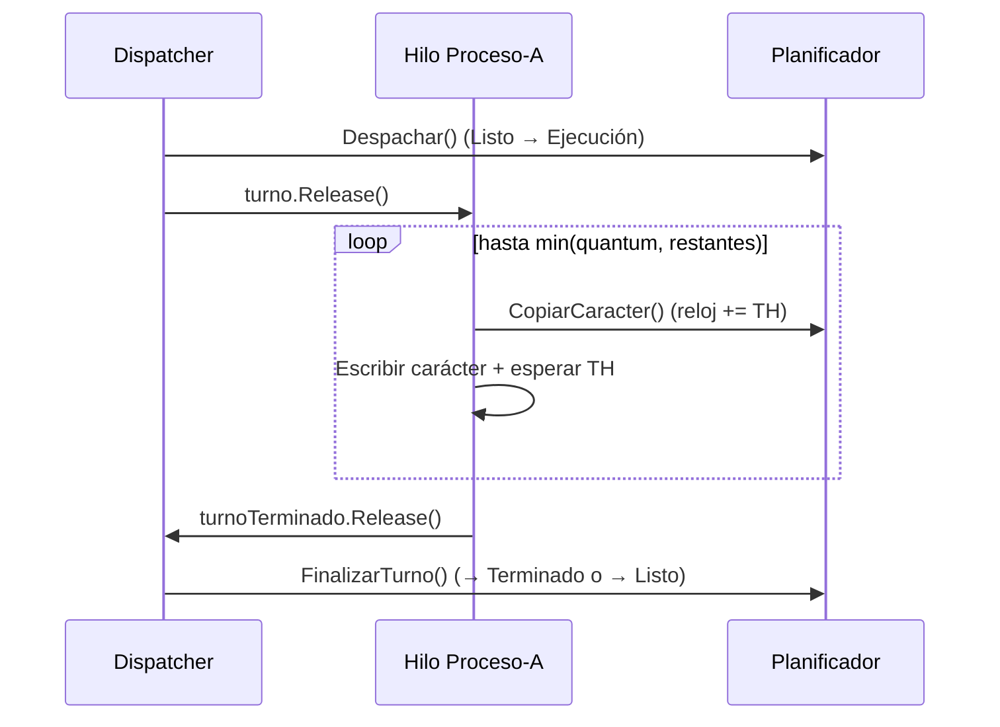

# Notas de sustentación: motor (M5)

Módulo M5 · Issue #29 · Rama `docs/m8-sustentacion-motor`.
Contrato: `ISimulador` (Core no se toca). Decisiones: ADR-0002 (concurrencia) y ADR-0003 (estructuras).

## 1. Qué hace y por qué está diseñado así

El motor simula Round Robin sobre procesos que copian su descripción carácter a carácter, con un hilo por proceso más un hilo dispatcher que reparte la CPU por turnos.
La lógica de planificación es determinista y sin hilos (`PlanificadorRoundRobin`); los hilos solo la envuelven para darle ritmo visual y pausa en vivo.
Los estados Listo y Terminado usan estructuras enlazadas propias (`ColaEnlazada`, `ListaEnlazada`) porque el enunciado pide estructuras dinámicas por estado y así se defienden en la pizarra.
Ejecución es un solo slot porque hay una sola CPU; Espera no es un estado, es una vista de Listo (procesos que ya usaron CPU y esperan turno).
El Engine es puro: sin UI, red, BD ni `Console`; todo lo observable sale por eventos e instantáneas inmutables.
El reloj simulado avanza TH por carácter copiado; el `Thread.Sleep` real solo controla la velocidad que ve el usuario.
Las fórmulas del enunciado (ráfaga, TL, TF) conviven con el tiempo real simulado para mostrar ambas en reportes y justificar la diferencia.

## 2. Recorrido del código (7 piezas)

1. `src/SimuladorProcesos.Engine/ISimulador.cs:7-33` — Contrato con la Web: `Cargar`, `Iniciar`, `Pausar`, `Reanudar`, `Reiniciar`, `ObtenerInstantanea`, `ObtenerReporte` y eventos `CambioEstado` / `SimulacionFinalizada`.
2. `src/SimuladorProcesos.Engine/Estructuras/ColaEnlazada.cs:21-52` y `ListaEnlazada.cs:22-36` — Listo es cola FIFO con punteros cabeza/cola; Terminado es lista con inserción al final; ambas O(1), con nodos propios en `Estructuras/Nodo.cs:5-8` y sin `List<T>`/`Queue<T>` dentro.
3. `src/SimuladorProcesos.Engine/Modelo/ProcesoSimulado.cs:12-18,57-60` — PCB del motor: `Quantum` (global o propio), `Rafaga = TH × caracteres`, `EnEspera` (en Listo con `Ejecuciones > 0`) y `SiguienteCaracter` que lee la descripción por índice.
4. `src/SimuladorProcesos.Engine/Planificacion/PlanificadorRoundRobin.cs:70-97` — `Despachar()` (Listo → Ejecución, `Ejecuciones++`, avisa) y `LimiteDelTurno()`: no expulsivo copia todo lo que le falta, expulsivo a lo sumo su quantum.
5. `src/SimuladorProcesos.Engine/Planificacion/PlanificadorRoundRobin.cs:100-140` — `CopiarCaracter()` avanza el reloj `TH` ms por carácter; `FinalizarTurno()` manda a Terminado si completó (con `TiempoFinalizacionReal = RelojMs`) o reencola al final de Listo si es expulsivo a medias.
6. `src/SimuladorProcesos.Engine/Calculos/CalculadoraTiempos.cs:10-31` — `Fila()` exige proceso Terminado; T.F del reporte es `Quantum × Ejecuciones` (enunciado) y T.R usa el TF real porque refleja la espera; fórmulas base en `src/SimuladorProcesos.Core/Formulas.cs:8-25`.
7. `src/SimuladorProcesos.Engine/SimuladorRoundRobin.cs:243-339,356-431` — Hilos: el proceso espera su `SemaphoreSlim` de turno, copia su límite y avisa; el dispatcher despacha, cede el turno y finaliza; `BajoLockSinPausa()` une espera de pausa + lock, y `Notificar()` dispara eventos fuera del lock.

## 3. Preguntas y respuestas modelo

### De CONTEXT §9 (las que tocan al motor)

**¿Por qué un hilo por proceso y qué hace el dispatcher?**
Porque el enunciado lo exige ("cada proceso mantiene su propio hilo"). El dispatcher es el único que reparte la CPU: desencola de Listos, cede el turno con un semáforo, espera a que el proceso termine su quantum y lo manda a Listo o Terminado (`SimuladorRoundRobin.cs:288-311`).

**¿Cómo funciona la pausa/reanudación y qué pasa al reiniciar?**
Pausar hace `Reset()` en un `ManualResetEventSlim` global; reanudar hace `Set()` (`SimuladorRoundRobin.cs:147,167`). Cada hilo lo espera antes de cada carácter y de cada despacho (`SimuladorRoundRobin.cs:356-373`). Reiniciar cancela con `CancellationTokenSource`, espera los hilos con `Join` de 2 s y recrea el planificador desde los procesos cargados (`SimuladorRoundRobin.cs:468-481`).

**¿De dónde sale cada fórmula (ráfaga, TL, TF, TAT)? ¿Por qué TF del enunciado difiere del tiempo real?**
R = TH × caracteres (`Formulas.cs:8-12`); TL = 0 si Listos vacía, si no TL último + 1 (`Formulas.cs:15-16`); TF enunciado = Quantum × Ejecuciones (`Formulas.cs:19`); TAT = TF real − TL (`CalculadoraTiempos.cs:20`). Difieren porque el TF del enunciado ignora el tiempo esperando turno; el reporte muestra ambos (CONTEXT §3, duda 4).

**¿Qué diferencia a un proceso expulsivo de uno no expulsivo en tu implementación?**
`ProcesoSimulado.EsExpulsivo` sale de la prioridad (`ProcesoSimulado.cs:31`). El límite del turno es `min(quantum, restantes)` si expulsivo y `restantes` si no (`PlanificadorRoundRobin.cs:93-97`). Solo un expulsivo a medias vuelve a Listo; un no expulsivo siempre termina en su primer turno (`PlanificadorRoundRobin.cs:132-139`).

**¿Qué estructura dinámica usaste para cada estado y por qué?**
Listo: `ColaEnlazada` FIFO O(1) porque Round Robin atiende en orden y reencola al final. Ejecución: slot único (una CPU). Terminado: `ListaEnlazada` con inserción al final en orden de finalización. Espera: vista derivada (`Listos` con `EnEspera`), no estructura aparte (ADR-0003, CONTEXT §3 duda 1).

**¿Cómo evitaste condiciones de carrera y bloqueos?**
Un solo `lock` protege planificador y estado; los eventos se acumulan y se disparan fuera del lock (`SimuladorRoundRobin.cs:20-25,408-431`). La exclusión de CPU es estructural: un semáforo de turno por proceso y uno de turno terminado, máximo un proceso con permiso (`SimuladorRoundRobin.cs:541-563`). Todas las esperas reciben el `CancellationToken`.

*(Las otras dos preguntas de §9 —cómo se obtienen usuario/descripción y cómo viaja la App 1 a la App 2— tocan a M1/M4/M6, no al motor.)*

### 5 probables del profesor

**¿Por qué el planificador no tiene hilos y para qué sirve?**
Para que la planificación sea determinista y probada sin esperas: `Despachar → CopiarCaracter × límite → FinalizarTurno`, con el reloj como contador (`PlanificadorRoundRobin.cs:7-11`). Los hilos solo ejecutan esos pasos con ritmo visual.

**¿Qué pasa con una descripción vacía?**
Su límite de turno es 0, así que al despacharse completa en ese mismo turno sin copiar caracteres y pasa a Terminado con el reloj actual (`PlanificadorRoundRobin.cs:93-97,124-131`).

**¿Por qué disparan los eventos fuera del lock?**
Porque un suscriptor (la UI) podría llamar de vuelta al motor y bloquearse; se copian los avisos bajo lock y se invocan fuera, con try/catch por suscriptor (`SimuladorRoundRobin.cs:407-431`).

**¿Cómo garantizan que nunca hay dos procesos en Ejecución?**
Solo el dispatcher llama `Despachar()`, y este lanza si la CPU está ocupada (`PlanificadorRoundRobin.cs:72-75`); además un proceso solo trabaja tras recibir su semáforo de turno (`SimuladorRoundRobin.cs:250,301`).

**¿Por qué `Thread` explícito y no `Task`/`ThreadPool`?**
Porque el enunciado pide hilos por proceso y en la sustentación se defiende mejor un `Thread` dedicado con nombre `Proceso-<pid>` e `IsBackground` (`SimuladorRoundRobin.cs:122,125`). El volumen esperado es de decenas de procesos (ADR-0002).

## 4. Diagrama (un turno expulsivo)

## 5. Si me preguntan algo que no sé

Di "no lo tengo verificado, lo miro en el código" y abre: transiciones en `Planificacion/PlanificadorRoundRobin.cs`, hilos en `SimuladorRoundRobin.cs:243-339`, tiempos en `Calculos/CalculadoraTiempos.cs` y fórmulas en `Core/Formulas.cs`. Razona desde el invariante: un turno siempre es despachar, copiar el límite exacto y finalizar; si algo se rompe, es porque ese orden se violó.
